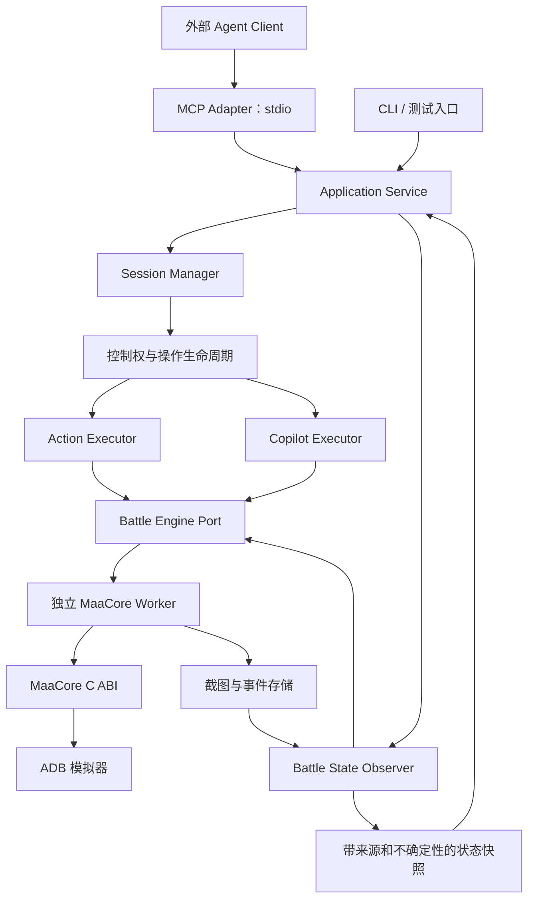

# MaaTactics：源码调查、架构决策与分阶段实施计划

## 第一部分：源码调查报告

### 1. 调查基线与验证范围

本次只进行了源码、配置、许可证和模型元数据的只读检查，没有修改源码、生成脚手架、提交 Git、创建仓库或操作游戏设备。

制定计划时的工作区现状：

- 正式项目目录 `MaaTactics/` 为空。
- 三个参考仓库均已存在于同级 `reference/`，无需重新获取。
- 三个参考仓库的工作区均干净。
- MAA 和 MaaFramework 的 MaaUtils 子模块尚未初始化。
- 没有进行原生构建、模型推理或真实设备测试。因此，下文区分“源码已确认”和“需要实施阶段实测”。

| 仓库 | 实际分支 | 实际 Commit SHA | 许可基线 | 构建方式 |
|---|---|---|---|---|
| MaaAssistantArknights | `dev-v2` | `67478591379d441e25a59156047c3f6163520fb7` | `AGPL-3.0-only`，由 `LICENSE.spdx` 明确声明 | CMake、MaaUtils/MaaDeps；可单独构建 MaaCore |
| MaaFramework | `main` | `07354c4e2e09a43e7edc12b8cb377d9137e1f584` | 根许可证为 LGPL v3 | CMake、MaaUtils/MaaDeps；Python 官方绑定包为 `maafw` |
| MaaAI | `main` | `7250cacc15c3b41c334937576d881845bee1ea71` | 仓库源码为 MIT | 各模型分别训练、导出，没有统一运行时构建入口 |

MAA 和 MaaFramework 的顶层 CMake 均声明最低版本 3.28；但当前 MAA Windows preset 使用 Visual Studio 2026 生成器，实际使用该 preset 应准备 **CMake 4.2+、Visual Studio 2026 C++ 工具链**。该生成器从 CMake 4.2 开始提供。[CMake 官方说明](https://cmake.org/cmake/help/latest/generator/Visual%20Studio%2018%202026.html)

MAA 原生构建建议使用：

```text
cmake --preset windows-x64
  -DBUILD_WPF_GUI=OFF
  -DBUILD_DEBUG_DEMO=OFF
  -DBUILD_RESOURCE_UPDATER=OFF
  -DINSTALL_RESOURCE=ON

cmake --build build --config Debug --target MaaCore
```

实施阶段在独立构建缓存中初始化必要子模块、下载 MaaDeps，不修改本次参考快照。MaaCore 仍会编译其现有任务代码；关闭 GUI 并不等于已经提取出了纯战斗库。

### 2. MAA 战斗调用链与可复用边界

实际调用关系如下：

```text
公开 C API
  AsstAppendTask → Assistant::append_task → InterfaceTask
  AsstStart      → Assistant::working_proc → task->run()

传统作业
  CopilotTask
    ├─ 前置任务与 BattleStartAll
    ├─ BattleFormationTask
    └─ BattleProcessTask
         ├─ CopilotConfig 中的动作与条件
         └─ BattleHelper
              ├─ 设备截图、点击、滑动
              ├─ 关卡格子投影
              ├─ 部署栏识别
              ├─ 技能与撤退操作
              └─ 内部干员位置、技能策略和计时状态

单步操作
  SingleStepTask
    ├─ stage  → 写入静态关卡名缓存
    ├─ start  → ProcessTask("BattleStartAll")
    └─ action → 新建 SingleStepBattleProcessTask
                  → calc_tiles_info
                  → do_action
                  → BattleHelper
```

关键源码依据：

| 子系统 | 已确认实现 | 对 MaaTactics 的含义 |
|---|---|---|
| 公开接口 | [AsstCaller.h](https://github.com/MaaAssistantArknights/MaaAssistantArknights/blob/67478591379d441e25a59156047c3f6163520fb7/include/AsstCaller.h#L59) 提供资源加载、实例创建、连接、任务、截图及停止接口 | MVP 可以通过 C ABI 接入，不需要访问私有 C++ 对象 |
| 任务生命周期 | [Assistant.cpp](https://github.com/MaaAssistantArknights/MaaAssistantArknights/blob/67478591379d441e25a59156047c3f6163520fb7/src/MaaCore/Assistant.cpp#L525) 管理任务线程、异步调用线程及消息线程 | 不能把某次 API 返回解释为原生执行已经结束 |
| 作业编排 | [CopilotTask.cpp](https://github.com/MaaAssistantArknights/MaaAssistantArknights/blob/67478591379d441e25a59156047c3f6163520fb7/src/MaaCore/Task/Interface/CopilotTask.cpp#L21) 组合启动、编队、战斗等任务 | 后续传统模式应直接复用，不先翻译成另一套作业格式 |
| 动作执行 | [BattleProcessTask.cpp](https://github.com/MaaAssistantArknights/MaaAssistantArknights/blob/67478591379d441e25a59156047c3f6163520fb7/src/MaaCore/Task/Miscellaneous/BattleProcessTask.cpp#L33) 负责条件等待、动作循环及策略轮询 | 包含领域逻辑，并非简单的点击列表 |
| 战斗上下文 | [BattleHelper.h](https://github.com/MaaAssistantArknights/MaaAssistantArknights/blob/67478591379d441e25a59156047c3f6163520fb7/src/MaaCore/Task/BattleHelper.h#L34) 保存格子投影、场上干员、技能策略、费用和计时信息 | 这些成员不是公开状态查询 API |
| 作业解析 | [CopilotConfig.cpp](https://github.com/MaaAssistantArknights/MaaAssistantArknights/blob/67478591379d441e25a59156047c3f6163520fb7/src/MaaCore/Config/Miscellaneous/CopilotConfig.cpp#L196) 解析动作、方向和条件 | 保留上游语义；不能只按文档示例手写兼容层 |
| 静态战斗数据 | [BattleDataConfig.cpp](https://github.com/MaaAssistantArknights/MaaAssistantArknights/blob/67478591379d441e25a59156047c3f6163520fb7/src/MaaCore/Config/Miscellaneous/BattleDataConfig.cpp#L6) 解析职业、部署类型、攻击范围等数据 | 静态资料不能当作当前战场观察 |
| 资源加载 | [ResourceLoader.cpp](https://github.com/MaaAssistantArknights/MaaAssistantArknights/blob/67478591379d441e25a59156047c3f6163520fb7/src/MaaCore/Config/ResourceLoader.cpp#L147) 同时加载战斗和大量非战斗资源 | 未修改加载器时，不能承诺只保留几个战斗资源文件即可运行 |

`BattleFormationTask` 已有分组选择、技能选择、缺失干员处理及部分练度检查。但它依赖编队 UI、资源模板、账号已有干员及具体关卡入口；不能将其包装成对任意界面都有效的“自动编队”。

普通 `CopilotTask` 的任务链结束也不总等于游戏战斗结束。是否等待结算与作业动作、`SkillDaemon`、多作业路径有关，服务必须分别报告“作业执行结束”和“战斗结果已观察”。

### 3. SingleStep 的六项结论

最重要的发现是：**官方文档与本次检查的源码存在参数形状差异。**

官方文档描述 `details` 为单个 action；源码却将 `details` 直接传给 `CopilotConfig::parse_actions()`，后者读取 `json.at("actions").as_array()`。[官方 SingleStep 文档](https://docs.maa.plus/zh-cn/protocol/integration.html)

因此，本次源码对应的调用形状应为：

```json
{
  "type": "copilot",
  "subtype": "action",
  "details": {
    "actions": [
      {
        "type": "Deploy",
        "name": "芬",
        "location": [4, 5],
        "direction": "Left"
      }
    ]
  }
}
```

依据为 [SingleStepTask.cpp](https://github.com/MaaAssistantArknights/MaaAssistantArknights/blob/67478591379d441e25a59156047c3f6163520fb7/src/MaaCore/Task/Interface/SingleStepTask.cpp#L52) 和前述 `parse_actions()`。这必须进入第一项原生契约测试，而不能仅通过 Mock 固化假设。

| 问题 | 调查结论 |
|---|---|
| 1. 能否通过公开 API 连续执行独立操作？ | **可以提交连续的 SingleStep 任务。** 每次等待上一任务真正停止运行后，再提交下一任务。部署以及按格子释放技能、撤退具有复用基础；按名称连续操作受到上下文丢失限制。 |
| 2. 是否需要复用内部战斗上下文？ | 连接和资源可复用同一 `AsstHandle`；但每次 `action` 都新建战斗任务。同一个 handle **不等于**同一个 `BattleHelper`。 |
| 3. 单步之间能保存什么？ | 关卡名保存在进程级静态缓存，格子投影每次重新计算。场上干员位置、技能策略、计时器等不随独立 action 自动保留。同一 `details.actions` 数组内部可以共享该任务上下文，但无法在数组中间插入外部 Agent 决策闭环。 |
| 4. 暂停、取消和查询是否可靠？ | 没有公开的战斗会话暂停/恢复及结构化状态 API。`AsstStop` 是协作式停止并清空任务队列，不是暂停游戏，也不代表独立异步连接/截图调用已经取消。状态主要靠回调和 `AsstRunning`。 |
| 5. 是否必须修改 MaaCore？ | 已确认的 MVP 边界不要求先修改。持久化按名称操作、完整状态读取、可恢复作业接管，需要小范围内部改造或等价公开扩展。 |
| 6. 现成二进制是否足够？ | **足以作为 MVP 首选验证路线，但尚未完成运行验证。** 必须先核实二进制与资源版本、实际参数契约、连续动作和停止行为。不能直接承诺任意 MAA 安装包都可用。 |

[SingleStepBattleProcessTask.cpp](https://github.com/MaaAssistantArknights/MaaAssistantArknights/blob/67478591379d441e25a59156047c3f6163520fb7/src/MaaCore/Task/Experiment/SingleStepBattleProcessTask.cpp#L24) 还暴露了两项限制：

- `_run()` 没有检查 `do_action()` 的返回值，动作失败后仍可能返回成功。
- `stage` 在 `AsstAppendTask` 解析参数时便写入静态缓存，而不是等到队列执行时才生效。不能预先排入不同关卡的任务并期待缓存按队列顺序隔离。

另外，`BattleHelper::deploy_oper()` 下发滑动后便登记内部位置，不能据此证明游戏已接受部署。

### 4. 已有视觉能力与缺口

当前主要实现名称是 `BattlefieldMatcher`、`BattlefieldClassifier`、`BattlefieldDetector`，不能假定所有能力都位于某个统一的 Analyzer 中。

| 状态字段 | 已有实现 | 主要限制 |
|---|---|---|
| 部署栏位置、职业、可用与冷却状态 | `BattlefieldMatcher` 的模板、颜色及 OCR 识别 | 遮挡、动画、皮肤和特殊模式可能影响结果 |
| 部署栏干员名称 | 头像缓存匹配；未知时点击详情页进行 OCR | 某些识别路径会暂停、选择干员并改变界面，不能作为纯只读观察调用 |
| 当前费用、击杀数/总数 | `BattlefieldMatcher` OCR，支持缓存命中状态 | 失败、缓存命中和新识别必须区分；没有统一可信概率 |
| 场上干员姓名与格子 | 主要由部署历史维护 | 不是通用视觉重建；手动操作、死亡、位移和装置可能使记录失效 |
| 技能 Ready | 已知位置附近的分类器；点击详情后的模板检查 | 依赖正确的位置和 ROI；不是所有技能状态或 SP 百分比 |
| 干员方向 | 已知格子中心附近的四分类器 | 不识别姓名；遮挡和特效需要验证 |
| 场上目标检测 | 单类血条/干员目标检测 | 输出框不提供干员身份，也不能直接给出完整战场语义 |
| 生命值、敌人身份、路径、完整 SP/CD | 没有确认可直接复用的通用能力 | 首版明确返回 unsupported/unknown |

[BattlefieldMatcher.h](https://github.com/MaaAssistantArknights/MaaAssistantArknights/blob/67478591379d441e25a59156047c3f6163520fb7/src/MaaCore/Vision/Battle/BattlefieldMatcher.h#L15) 已区分识别失败、成功和缓存命中；MaaTactics 应保留这些差异。

官方作业协议也提示费用 OCR 等字段存在局限，因此不能用协议中“支持某条件”推导“该状态在所有场景可靠”。[官方战斗流程协议](https://docs.maa.plus/zh-cn/protocol/copilot-schema.html)

### 5. MaaFramework 调查结论

| 能力 | 源码接口 | 对本项目的判断 |
|---|---|---|
| 设备控制与截图 | `MaaAdbControllerCreate`、`MaaControllerPostConnection/PostScreencap/PostClick/PostSwipe` | 控制器接口完整，异步请求具有 ID、Status、Wait |
| Pipeline | recognition、action、next、超时等节点结构 | 是通用自动化流程，不是 Copilot 战斗协议 |
| 图像识别 | 模板、特征、OCR、神经网络分类/检测、Custom | 可作为观察基础，但需配置模型、前后处理和领域映射 |
| 自定义扩展 | `MaaResourceRegisterCustomRecognition/CustomAction`、`MaaContext` | 适合承载移植后的战斗逻辑 |
| 事件与详情 | Sink、Tasker 状态、识别和动作详情查询 | 比 MaaCore 当前战斗公开 API 更便于服务化 |
| Python/C++ | 官方 Python 绑定及 C API；项目主体使用 C++20 | 接入成熟，但不自动获得 MAA 战斗能力 |

接口依据：[MaaController.h](https://github.com/MaaXYZ/MaaFramework/blob/07354c4e2e09a43e7edc12b8cb377d9137e1f584/include/MaaFramework/Instance/MaaController.h#L225)、[MaaTasker.h](https://github.com/MaaXYZ/MaaFramework/blob/07354c4e2e09a43e7edc12b8cb377d9137e1f584/include/MaaFramework/Instance/MaaTasker.h#L56)。

采用 MaaFramework 仍需迁移：

- Copilot 解析、分组与条件等待语义。
- 格子投影、镜头变化及关卡资料。
- 干员名称识别与头像缓存。
- 部署手势、方向选择、技能与撤退操作。
- 作业编队、流程推进和异常恢复。
- 战斗上下文及自动技能策略。
- MAA 任务模板、配置和资源加载依赖。

MAA 已存在复用 MaaFramework 控制单元的可选路径，但这不表示二者引擎和任务 API 可互换。MaaFramework 的 `AgentClient/AgentServer` 是自定义逻辑的进程通信机制，也不是 MCP 或内置 LLM Agent。

### 6. MaaAI：源码、权重和运行时分离

MaaAI 当前仓库没有上述模型的已提交权重文件；实际 ONNX 文件存在于 MAA 的 `resource` 中。本次直接读取了这些 ONNX 文件的 Protobuf 张量元数据，没有执行推理。

以下均为 float32：

| 模型 | 已核对的输入 → 输出 | 可提供字段 | 限制 |
|---|---|---|---|
| 技能状态分类，约 9.96 MB | `input: [N,3,64,64]` → `output: [N,3]` | `c/n/y` 类别、原始输出及分类分数 | `y` 才代表 Ready；分数不等于校准后的正确概率 |
| 场上目标检测，约 12.24 MB | `images: [1,3,640,640]` → `output0: [1,5,8400]` | 框、单类分数 | 不提供姓名、职业或唯一身份 |
| 部署方向，约 18.90 MB | `input: [1,3,96,96]` → `output: [1,4]` | 右、下、左、上 | 必须先有可靠目标位置 |
| 普通 OCR rec，约 21.22 MB | `[N,3,48,W]` → `[N,T,18710]` | 配合字典解码的文字 | 必须匹配对应 `keys.txt` 和预处理 |
| 字符 OCR rec，约 12.12 MB | `[N,3,48,W]` → `[N,T,96]` | 数字等字符 | 与普通 OCR 字典不同 |
| OCR det，约 9.96 MB | `[N,3,H,W]` → `[N,1,H',W']` | 文本区域概率图，经后处理得到框 | MaaAI OCR 目录主要提供 rec 微调流程，det 来源需另查 |

运行时前处理已从 MAA 核实：

- 通用 ONNX 图像转 RGB、CHW、float32，并缩放到 `[0,1]`。
- Ready 模型还有 72×72 缩放、64×64 中心裁剪及归一化。
- 检测器将原图分别按横纵比例缩放到 640×640，后处理采用对应坐标还原与 NMS。
- 方向识别取格子中心附近 96×96 ROI。

依据：[BattlefieldClassifier.cpp](https://github.com/MaaAssistantArknights/MaaAssistantArknights/blob/67478591379d441e25a59156047c3f6163520fb7/src/MaaCore/Vision/Battle/BattlefieldClassifier.cpp#L45)、[BattlefieldDetector.cpp](https://github.com/MaaAssistantArknights/MaaAssistantArknights/blob/67478591379d441e25a59156047c3f6163520fb7/src/MaaCore/Vision/Battle/BattlefieldDetector.cpp#L35)。

MaaAI README 宣称的 CPU 延迟仅作参考，不能作为验收数据：Ready 小于 1 ms、检测约 50 ms、方向约 20 ms，未注明本项目测试硬件。本项目需要重新测量端到端截图、推理和操作延迟。

训练环境与发布运行时分开：

- 训练涉及 PyTorch、torchvision、timm、PaddleOCR 或 Ultralytics 等。
- MVP 复用 MaaCore 自带推理路径，不安装完整训练依赖。
- MIT 仓库源码许可不能自动证明外部预训练权重、数据集和导出权重均可按 MIT 分发。
- `operators/requirements.txt` 固定到 Ultralytics `8.0.54` 系列；检查该 tag 的许可证为 GPL v3，不能套用其当前版本许可或 MaaAI 的 MIT 作统一结论。[对应版本许可证](https://github.com/ultralytics/ultralytics/blob/v8.0.54/LICENSE)

---

## 第二部分：架构决策记录

### ADR-001：优先使用方案 A，按实际缺口增加小范围 MaaCore 补丁

| 评估项 | A：MaaCore 包装 | B：提取战斗模块 | C：MaaFramework＋迁移 |
|---|---|---|---|
| 开发工作量 | 最低；先验证 SingleStep | 高；资源、任务、控制与全局配置耦合明显 | 最高；需重建大量战斗领域行为 |
| Copilot 兼容 | 最好，直接使用原解析器与执行器 | 提取完整依赖后可较高兼容 | 需迁移解析器和执行语义 |
| 实时操作 | 坐标操作可先验证；持久上下文不足 | 可设计为完整会话引擎 | 调度接口适合，但领域执行尚需实现 |
| 状态访问 | 当前公开 API 较弱 | 可以直接设计快照接口 | 通用识别详情较好，战斗状态需自行构建 |
| 上游同步 | 未修改时最低；小补丁可控 | 高，容易形成长期分叉 | 控制层同步较低，战斗迁移仍需人工跟踪 |
| 跨平台 | 跟随 MaaCore 可用构建与控制器 | 自行维护提取后的构建矩阵 | 控制器跨平台基础较好 |
| 构建与分发 | 外置运行时最简单；资源较重 | 初期复杂，稳定后可精简 | 自身包较成熟，但迁移资源仍复杂 |
| 许可与资源 | AGPL 和资源独立权利需审计 | 复制 MAA 代码后采用 AGPL 候选 | LGPL 基础不消除移入 MAA 代码的 AGPL 义务 |
| Agent 扩展 | 包装层可扩展；深层能力需补丁 | 长期自由度高 | 自由度高，但首期重复工作最多 |

工作量仅作排期估算：一名熟悉相关技术的工程师，在设备可用的条件下，A 的 MVP 约 **6–10 个工作日**；B、C 涉及的完整兼容迁移均应按数周至数月评估，不能视作同等成本替代。

**推荐演进顺序：**

1. **MVP：A，未修改 MaaCore＋独立 Python 服务。**
2. **增强：A 的小补丁形态**，增加每实例持久上下文、真实动作结果和只读快照。
3. **长期：有选择地提取 B。** 只有在补丁和资源依赖已明确、测试基线稳定后才提取。
4. **C 保留为替代研究路线**，不作为默认重写方向。

本轮不选择 B、C 的主要原因是：源码已经存在可调用的 SingleStep 路径，而主要缺口集中于生命周期、状态和公开接口；现在整体迁移会扩大验证面。

### ADR-002：MVP 的明确边界

按已确认的偏好，MVP 固定为：

- Windows x64＋ADB 模拟器，使用 MaaTouch 或经验证的触控模式。
- 用户手动进入普通演习战斗，默认先验证 `1-7`。
- 支持部署，以及**按格子**释放技能和撤退。
- 使用外置、经版本校验的完整 MaaCore 运行时与资源目录。
- 服务独立启动，不启动 MAA GUI。
- 前后截图交给外部 Agent 或人工确认生效；服务无法确认时返回 `unknown`。
- Agent 推理期间游戏继续运行；断开、取消和超时后停止新输入。
- 首版不承诺自动暂停游戏、完整战场识别、自动编队或混合接管。

官方自动战斗说明要求稳定帧率及合适触控模式；真实设备验收将记录这些条件。[官方自动战斗说明](https://docs.maa.plus/zh-cn/manual/introduction/copilot.html)

### ADR-003：依赖、许可与同步方式

**正式仓库保持全新 MaaTactics。**

MVP 不采用完整上游 Submodule、Subtree 或源码复制：

- Python 依赖用包管理器和锁文件管理。
- MaaCore 采用外置运行时；正式仓库记录源码 SHA、二进制来源、平台、资源版本和 SHA-256。
- 优先使用能证明对应关系的上游构建产物；找不到时，在独立缓存中构建本次固定 SHA。
- 不仅凭 `AsstGetVersion()` 字符串判定来源可信。
- 后续补丁放在独立补丁目录，记录基线 SHA、目的及上游关联；不直接修改 `reference`。
- 真正提取代码时，逐文件记录上游路径、提交、版权、许可证及修改说明。

许可与分发处理：

| 对象 | 处理方案 |
|---|---|
| MaaTactics 新代码及复制的 MAA 代码 | 默认采用 `AGPL-3.0-only` 候选；保留原版权、许可证、修改标记和对应源码 |
| 动态链接 MaaCore | 不把动态链接或进程隔离当作免除 AGPL 义务的方法 |
| MaaFramework | 若后续分发，保留 LGPL 文本、库来源和修改源码，并满足适用的替换、重新链接等条件 |
| MaaAI 源码 | 保留 MIT 版权与许可；依赖另行列明 |
| 模型权重 | 每个文件记录下载来源、哈希、训练/预训练来源和授权依据；来源不清的权重不随 MaaTactics 分发 |
| 游戏图片、地图、字体等 | 单独审计；MAA 用户协议明确部分游戏资源版权属于鹰角网络 |
| MAA Logo | 不复用；MAA 明确声明 Logo 不适用其 AGPL 授权 |
| 原生第三方库 | 随发布清单保留许可；首版选择 CPU 推理，减少 GPU 组件分发负担 |

许可依据包括本地 [MAA 许可声明](https://github.com/MaaAssistantArknights/MaaAssistantArknights/blob/67478591379d441e25a59156047c3f6163520fb7/LICENSE.spdx#L1)、[MaaFramework 许可证](https://github.com/MaaXYZ/MaaFramework/blob/07354c4e2e09a43e7edc12b8cb377d9137e1f584/LICENSE.md#L1)、[MaaAI 许可证](https://github.com/MaaAssistantArknights/MaaAI/blob/7250cacc15c3b41c334937576d881845bee1ea71/LICENSE#L1) 及 [MAA 资源权利声明](https://github.com/MaaAssistantArknights/MaaAssistantArknights/blob/67478591379d441e25a59156047c3f6163520fb7/terms-of-service.md#L121)。发布前需针对最终依赖清单完成许可复核，不能只审核三个根许可证。

上游同步采用“显式升级”：

1. MVP 通过前冻结基线。
2. 发布后每月或遇关键修复时检查一次上游。
3. 候选升级先跑参数契约、回放、停止及真实设备测试，再更新锁文件。
4. 文档参数差异、动作结果丢失等通用问题整理为上游修复候选。
5. 向上游提交修改不与 MaaTactics 发布绑定，也不在本阶段创建 PR。

---

## 第三部分：MaaTactics 技术架构

### 1. 组件与依赖



| 模块 | 职责 |
|---|---|
| Device Controller | 连接、截图、设备状态；MVP 由 MaaCore 后端实现 |
| Battle Engine | 关卡绑定、战术操作、战斗执行上下文；不依赖 MCP |
| Battle State Observer | 将截图、静态资料、回调和动作历史组合成有来源的观察 |
| Action Executor | 串行提交、前置检查、超时、取消、证据采集 |
| Copilot Executor | 管理原生作业运行；后续接管时仍使用同一执行和控制权边界 |
| Session Manager | 会话、代际、操作记录、失效和清理 |
| MCP Adapter | JSON Schema、Tools、Resources、协议错误和 Image Content |

MVP 中 Agent 操作与原生 Copilot 共用同一后端入口及控制权锁。原生 Copilot 内部仍由上游执行；直到持久上下文补丁完成，不能声称二者已经共享同一个完整战斗对象。

### 2. 语言与进程选择

- **应用服务、MCP、Mock：Python 3.12。**
- **MCP：官方 Python SDK v2 稳定系列，锁定实际安装版本。**
- **原生执行：现有 C++ MaaCore，通过最小 `ctypes` 绑定接入。**
- MVP 不引入 pybind11，不复制整套上游 Python 包，也不引入 Python 训练环境。
- 后续必须改动的战斗上下文留在 C++，通过窄 C ABI 暴露。

官方 SDK 当前稳定文档为 v2，要求 Python 3.11+；本项目统一使用 3.12，并通过锁文件控制升级。[官方 Python SDK](https://py.sdk.modelcontextprotocol.io/)

每个活跃会话使用一个新建 Worker 进程，进程内仅创建一个 MaaCore handle。原因包括：

- SingleStep 关卡缓存和资源配置具有进程级状态。
- 原生销毁会等待多个线程结束。
- 原生调用可能阻塞。
- Debug 日志可能写 `stdout`。

Worker 使用私有 IPC；其 stdout/stderr 被父进程接管并送入日志，不能继承 MCP stdout。MCP stdout 只输出协议消息，日志输出 stderr。[MCP stdio 规范](https://modelcontextprotocol.io/specification/2025-11-25/basic/transports)

### 3. 会话、状态及操作模型

MVP 每个服务实例仅允许一个活跃设备会话。

```text
Session：
connecting → connected → ready → executing
                         ↑          ↓
                    needs_reobserve
任意活跃状态 → stopping → closed
原生故障    → faulted → closed

控制权：
none | agent | copilot | handover
```

`ready` 仅表示设备、关卡绑定和操作前置条件就绪，不自动代表游戏正在战斗。

会话至少包含：

```text
session_id、epoch、worker_generation
device_profile、runtime_fingerprint
connection_status、last_health_check_at
stage_id、control_owner、active_operation_id
latest_snapshot_id、capabilities
```

关键规则：

- 关卡变更、断连、Worker 重建、执行超时或上下文失效时递增 `epoch`。
- 旧 epoch 的动作被拒绝。
- 同一时刻只有一个输入操作或原生作业持有执行权；其他输入立即返回 `BUSY`。
- 不预排无界动作队列。
- 普通截图也不能随意穿插进原生任务的输入流程；执行期间只允许读取符合新鲜度要求的缓存，否则返回 `BUSY`。
- 回调按 Worker 代际和任务 ID 关联；异步调用 ID 与任务 ID 分开。
- 回调只复制数据、入队，不执行阻塞工作或销毁 handle。
- 下一操作必须等终结回调及 `AsstRunning=false`；不能收到 `TaskChainCompleted` 就立即开始下一任务。

操作结果明确分三层：

```json
{
  "operation_id": "op-1",
  "lifecycle": "completed",
  "request_status": "accepted",
  "native_task_outcome": "completed",
  "input_execution": "unknown",
  "game_effect": "unknown",
  "before_snapshot_id": "frame-1",
  "after_snapshot_id": "frame-2",
  "warnings": ["MaaCore task completion does not prove game effect"]
}
```

SingleStep 回调不能证明实际输入成功时，`input_execution` 必须保留 `unknown`。外部 Agent 的截图判断不自动改写成服务已验证的事实。

观察字段采用：

```text
Field<T>：
value: T | null
status: known | unknown | unsupported | stale
source: vision | configuration | intent_log | upstream_callback
observed_at: RFC3339 UTC | null
confidence: number | null
evidence_snapshot_id: string | null
```

MVP 中：

- 费用、击杀数、技能状态和完整部署名单默认 unsupported/unknown。
- 动作历史记录为 `intent_log`，不能直接冒充“已部署干员”。
- 截图记录采集开始、完成时间和帧 ID；不伪造设备端精确拍摄时间。
- 超时使用单调时钟，面向接口的时间使用 UTC。

### 4. 取消、失效与恢复

正常取消流程：

1. 停止接受后续输入。
2. 通过独立控制通道请求 `AsstStop`，不排在阻塞动作之后。
3. 等待任务退出，同时处理尚未完成的异步调用。
4. 确认静止后销毁或恢复到需要重新观察的状态。

默认宽限期 3 秒；再等待最多 1 秒退出。原生仍不响应时终止 Worker，并将会话标记为故障。

终止进程不能撤销已经发出的手势，结果仍可能为 unknown。此时必须新建会话、重设关卡并重新截图，禁止直接重试原动作。不得调用 `adb kill-server` 影响其他程序。

Agent EOF/断开触发同样的停止和清理；不自动点击暂停按钮。推理期间没有“无调用即自动点击”的后台行为。

对有副作用的请求要求 `request_id`：

- 同一会话、epoch、request_id 和相同参数返回原操作。
- 相同 request_id、不同参数返回冲突。
- 不自动重试部署、技能或撤退。
- 每会话最多保存 1,000 条操作及去重记录；达到上限拒绝新动作。
- 关闭会话后保留查询记录 5 分钟；进程重启后的旧会话 ID 无效。

### 5. 建议目录

以下为实施后的目录规划，本轮不创建：

```text
MaaTactics\
├─ pyproject.toml
├─ uv.lock
├─ LICENSE
├─ THIRD_PARTY_NOTICES.md
├─ upstream.lock.json
├─ src\maatactics\
│  ├─ domain\             # 会话、动作、观察、错误类型
│  ├─ application\        # Session、Action、Copilot 服务
│  ├─ ports\              # 与协议无关的引擎和观察接口
│  ├─ backends\
│  │  ├─ mock\
│  │  └─ maacore\         # ABI、参数适配、Worker、回调
│  ├─ observers\          # 后续被动识别与验证
│  └─ adapters\
│     ├─ mcp\
│     └─ cli\
├─ tools\                 # 原生契约探针、回放和诊断
├─ tests\                 # 单元、协议、Mock、回归、设备
├─ docs\                  # ADR、接口、验收记录
└─ patches\maacore\       # 后续有补丁时才加入
```

运行时、日志、截图和构建缓存不提交。Linux/macOS 扩展沿用相同端口和测试契约，分别提供匹配平台的原生运行时，再增加设备验收矩阵。

---

## 第四部分：MCP 接口设计

### 1. MVP Tools

服务名：`maatactics-mcp`。

MVP 不启用远程传输，不要求 MCP Tasks 扩展。长操作使用普通 Tool 返回领域级 `operation_id`，再查询状态。

| Tool | 行为与返回 | 前置条件 | 底层调用 | 时限与取消 |
|---|---|---|---|---|
| `connect_device` | 异步返回会话及操作凭据；结果包含运行时版本、连接状态、能力 | 无其他活跃会话；profile 已在启动配置中声明 | LoadResource、CreateEx、SetInstanceOption、AsyncConnect | 默认 30 秒；可取消，失败后关闭 Worker |
| `get_session_status` | 同步返回会话、epoch、控制权、活跃操作、最近健康检查 | 可无会话；传入 ID 时必须存在 | 应用状态及 Worker 最近状态 | 1 秒；取消只结束查询 |
| `disconnect_device` | 异步清理；重复调用返回原关闭结果 | 已创建会话，包括 faulted 状态 | 停止、等待、Destroy、退出 Worker | 最多 5 秒，必要时终止 Worker |
| `get_screenshot` | 同步返回 Image Content、截图元数据和 Resource URI | 已连接；无冲突操作或存在合格缓存 | AsyncScreencap 完成后 GetImage | 5 秒；取消后仍需处理原生在途调用 |
| `get_battle_state` | 同步返回最近快照、字段可用性和动作意图历史 | 会话存在 | Observer 缓存 | 1 秒，不隐式点击或识别未知干员 |
| `set_stage` | 异步绑定关卡；成功后返回新 epoch 和地图摘要 | 已连接、执行器空闲 | SingleStep stage；检查地图文件 | 2 秒；取消不进行游戏输入 |
| `deploy_operator` | 异步返回操作；结束时附前后截图 | ready、Agent 持有控制权、观察未过期 | SingleStep Deploy，`details.actions=[action]` | 默认 10 秒，上限 30 秒；协作取消 |
| `retreat_operator` | 按格子撤退，返回操作及证据 | 同上；格子在当前地图内 | SingleStep Retreat＋location | 同上 |
| `use_skill` | 按格子尝试使用技能，返回操作及证据 | 同上 | SingleStep Skill＋location，原生 `timeout=0` | 不无限等待 Ready；操作总时限仍受监督 |
| `get_operation` | 同步返回操作状态、原生结果、错误和证据 URI | 操作记录存在，关闭后保留期内也可查询 | 操作注册表 | 1 秒，取消查询不取消动作 |
| `cancel_operation` | 返回取消请求状态及目标操作 ID | 操作存在；终态调用为幂等 | 控制通道＋AsstStop，必要时关闭 Worker | 3＋1 秒；已发出的输入无法撤销 |
| `stop_operations` | 停止当前输入、清空待执行工作并使战术上下文失效 | 会话存在；不受旧 epoch 阻挡 | 同上 | 同上；不表示暂停或退出游戏 |

设备路径、ADB 地址、资源目录和触控模式放在本地 profile 中；Agent 只能选择 profile ID，不能通过 Tool 任意指定可执行文件或命令。

`set_stage` 仅设置地图上下文，不导航关卡。MVP 的验证 allowlist 默认只有普通 `1-7`；后续关卡逐项加入。

### 2. 输入 JSON Schema

下面给出共享定义和每个输入契约。发布到 `tools/list` 时，将对应定义展开成完整的独立 schema，根对象关闭额外属性，并使用 Draft 2020-12 校验。

```json
{
  "$schema": "https://json-schema.org/draft/2020-12/schema",
  "$defs": {
    "id": {
      "type": "string",
      "minLength": 1,
      "maxLength": 128
    },
    "session": {
      "type": "object",
      "properties": {
        "session_id": {"$ref": "#/$defs/id"},
        "epoch": {"type": "integer", "minimum": 1}
      },
      "required": ["session_id", "epoch"]
    },
    "session_id_only": {
      "type": "object",
      "properties": {
        "session_id": {"$ref": "#/$defs/id"}
      },
      "required": ["session_id"],
      "additionalProperties": false
    },
    "operation_ref": {
      "type": "object",
      "properties": {
        "session_id": {"$ref": "#/$defs/id"},
        "operation_id": {"$ref": "#/$defs/id"}
      },
      "required": ["session_id", "operation_id"],
      "additionalProperties": false
    },
    "location": {
      "type": "array",
      "items": {"type": "integer", "minimum": 0},
      "minItems": 2,
      "maxItems": 2
    },
    "action": {
      "allOf": [{"$ref": "#/$defs/session"}],
      "properties": {
        "request_id": {"$ref": "#/$defs/id"},
        "expected_snapshot_id": {"$ref": "#/$defs/id"},
        "timeout_ms": {
          "type": "integer",
          "minimum": 1000,
          "maximum": 30000,
          "default": 10000
        }
      },
      "required": ["request_id", "expected_snapshot_id"]
    },
    "connect_device": {
      "type": "object",
      "properties": {
        "device_profile": {"$ref": "#/$defs/id"},
        "request_id": {"$ref": "#/$defs/id"},
        "timeout_ms": {
          "type": "integer",
          "minimum": 1000,
          "maximum": 60000,
          "default": 30000
        }
      },
      "required": ["device_profile", "request_id"],
      "additionalProperties": false
    },
    "get_session_status": {
      "type": "object",
      "properties": {
        "session_id": {"$ref": "#/$defs/id"}
      },
      "additionalProperties": false
    },
    "disconnect_device": {
      "$ref": "#/$defs/session_id_only"
    },
    "get_screenshot": {
      "allOf": [{"$ref": "#/$defs/session"}],
      "properties": {
        "max_age_ms": {
          "type": "integer",
          "minimum": 0,
          "maximum": 1000,
          "default": 0
        }
      },
      "unevaluatedProperties": false
    },
    "get_battle_state": {
      "allOf": [{"$ref": "#/$defs/session"}],
      "unevaluatedProperties": false
    },
    "set_stage": {
      "allOf": [{"$ref": "#/$defs/session"}],
      "properties": {
        "request_id": {"$ref": "#/$defs/id"},
        "stage_name": {
          "type": "string",
          "minLength": 1,
          "maxLength": 256
        }
      },
      "required": ["request_id", "stage_name"],
      "unevaluatedProperties": false
    },
    "deploy_operator": {
      "allOf": [{"$ref": "#/$defs/action"}],
      "properties": {
        "name": {
          "type": "string",
          "minLength": 1,
          "maxLength": 128
        },
        "location": {"$ref": "#/$defs/location"},
        "direction": {
          "enum": ["Right", "Down", "Left", "Up"]
        }
      },
      "required": ["name", "location", "direction"],
      "unevaluatedProperties": false
    },
    "retreat_operator": {
      "allOf": [{"$ref": "#/$defs/action"}],
      "properties": {
        "location": {"$ref": "#/$defs/location"}
      },
      "required": ["location"],
      "unevaluatedProperties": false
    },
    "use_skill": {
      "allOf": [{"$ref": "#/$defs/action"}],
      "properties": {
        "location": {"$ref": "#/$defs/location"}
      },
      "required": ["location"],
      "unevaluatedProperties": false
    },
    "get_operation": {
      "$ref": "#/$defs/operation_ref"
    },
    "cancel_operation": {
      "$ref": "#/$defs/operation_ref"
    },
    "stop_operations": {
      "$ref": "#/$defs/session_id_only"
    }
  }
}
```

补充语义校验：

- `location` 按 MAA 地图坐标解释，并校验实际地图边界。
- 关卡名称必须唯一解析为固定关卡 ID；歧义时拒绝，不取第一个匹配。
- 初版部署名称使用当前客户端对应名称；同名歧义、召唤物及特殊装置暂不支持。
- `expected_snapshot_id` 必须属于当前 epoch，且是最近向调用方提供的快照，默认年龄不超过 5 秒。
- 执行前再次采集证据帧；这仍不保证游戏状态被冻结。

### 3. 返回类型与错误

所有成功 Tool 结果包含 `schema_version`；除图片外，结构化数据放入 `structuredContent`。图片通过标准 Image Content 或图片 Resource 提供，不放入普通业务 JSON 的 base64 字段。[MCP Tools](https://modelcontextprotocol.io/specification/2025-11-25/server/tools)

共享返回类型：

| 类型 | 必需字段 |
|---|---|
| `OperationReceipt` | session_id、epoch、operation_id、lifecycle、accepted_at、deadline_at |
| `OperationResult` | Receipt 字段、native_task_outcome、input_execution、game_effect、error、warnings、前后快照 ID |
| `SessionStatus` | session_id、epoch、状态、连接检查时间、控制权、stage、active_operation_id、capabilities |
| `SnapshotMetadata` | snapshot_id、session_id、epoch、采集开始/完成时间、宽高、mime_type、image_uri |
| `BattleState` | snapshot_id、observed_at、age_ms、字段状态、intent_log、warnings |
| `Error` | code、message、retryable、operation_id、recovery、effect_may_have_occurred |

主要错误及适用范围：

| 错误 | 适用 Tool | 恢复 |
|---|---|---|
| `SESSION_INVALID` / `EPOCH_MISMATCH` | 会话、截图、状态、战术操作 | 获取当前会话；旧会话重新连接 |
| `BUSY` | 连接、设关、截图、战术操作 | 查询当前操作后再调用 |
| `STALE_OBSERVATION` | 战术操作 | 重新截图和决策 |
| `STAGE_UNSUPPORTED` / `STAGE_AMBIGUOUS` | set_stage、战术操作 | 使用已验证且唯一的关卡 |
| `NATIVE_REJECTED` | 连接、设关、动作 | 查看契约或资源诊断，不盲重试 |
| `DEVICE_DISCONNECTED` | 所有原生操作 | 终止会话，重新连接和观察 |
| `TIMEOUT` / `CANCELLED` | 长操作 | 查询终态；重新建立可信上下文 |
| `REQUEST_CONFLICT` | 带 request_id 的操作 | 使用原参数查询，或为新意图生成新 ID |
| `RATE_LIMITED` / `SESSION_LIMIT` | 高频调用、新操作 | 降频或明确结束当前会话 |
| `RESOURCE_EXPIRED` | 截图 Resource | 获取新截图 |
| `OPERATION_NOT_FOUND` | 操作查询、取消 | 检查会话与保留期限 |

Tool 业务失败使用 `isError=true`；协议格式、未知方法或参数结构错误由 SDK 按协议返回。已经接受的后台操作，其失败保存在 `OperationResult`，不会因一次查询失败而丢失。

MCP 请求取消与领域操作取消分开：取消一次 `get_operation` 只结束查询；已返回凭据的动作需要调用 `cancel_operation`。[MCP 取消规范](https://modelcontextprotocol.io/specification/2025-11-25/basic/utilities/cancellation)

### 4. Resources 与限流

MVP Resources：

```text
maatactics://about
maatactics://sessions/{session_id}/status
maatactics://sessions/{session_id}/state
maatactics://sessions/{session_id}/snapshots/{snapshot_id}.json
maatactics://sessions/{session_id}/snapshots/{snapshot_id}.png
```

- `about` 提供服务版本、运行时指纹、能力和许可/源码链接。
- Resource 读取不隐式截图或发出输入。
- 图片 Resource 返回 `image/png` 的标准二进制内容。
- 首版不声明尚未实现的订阅能力。[MCP Resources](https://modelcontextprotocol.io/specification/2025-11-25/server/resources)

默认限制：

- 实际新截图最多 2 次/秒，每会话最多一个在途截图。
- 操作查询建议不超过 5 次/秒；状态查询上限 10 次/秒。
- 图片存储最多 20 帧或 64 MiB，先达到者触发淘汰；最长保留 120 秒。
- 单帧 PNG 上限 8 MiB，超限返回明确错误。
- 去重和限流在服务端执行，不依赖 Agent 自觉。

### 5. 调用示例

```text
connect_device(profile)
→ get_operation，等待 connected
→ set_stage("1-7")
→ get_operation，取得新 epoch
→ 用户手动进入演习战斗
→ get_screenshot
→ Agent 观察与决策
→ deploy_operator
→ get_operation
→ 读取动作前后截图，Agent 验证
→ get_screenshot
→ 下一次部署 / 按格子技能 / 按格子撤退
→ stop_operations
→ disconnect_device
```

部署调用示例：

```json
{
  "name": "deploy_operator",
  "arguments": {
    "session_id": "s-1",
    "epoch": 2,
    "request_id": "deploy-001",
    "expected_snapshot_id": "frame-10",
    "name": "芬",
    "location": [4, 5],
    "direction": "Left",
    "timeout_ms": 10000
  }
}
```

### 6. 后续接口

以下接口不在 MVP 中公开为可用功能：

| 阶段 | 接口与契约方向 |
|---|---|
| 传统作业 | `load_copilot(document)` 返回 copilot_id、内容哈希、校验结果；保留官方 JSON 内容 |
| 传统作业 | `start_copilot(copilot_id, formation=false)` 返回 operation_id/run_id；默认单次运行，不用理智药 |
| 传统作业 | `get_copilot_progress(run_id)` 返回任务链状态、最后宣布的动作、错误及结束证据；无证据时不宣称动作已成功 |
| 可验证战斗控制 | `start_battle`、`pause_battle`、`resume_battle`、`set_battle_speed(speed=1\|2)`；必须验证游戏状态，不能直接包装切换点击 |
| 结构化观察 | `get_deployable_operators`、`get_deployed_operators`；返回字段来源、帧 ID、分数及 unknown |
| 混合控制 | `pause_copilot(run_id)` 返回安全点 checkpoint；`resume_copilot(run_id, checkpoint_id, revision)` |
| 混合修改 | `patch_copilot` 只允许在 checkpoint 下替换或跳过尚未执行的动作，并校验 expected_revision |

`stop_battle` 暂不采用该名称：停止自动输入与点击放弃战斗是不同操作。未来若需要放弃，提供语义明确的独立接口。

---

## 第五部分：详细开发路线图

以下工期为单工程师的估算区间，不包含等待设备、授权澄清或上游响应。

### P0：原生 SingleStep 契约验证——MVP 必需

**目标：** 验证路线 A 的真实入口，先排除文档、ABI 和资源问题。预计 1–2 天。

- **前置依赖：** Python 3.12；固定来源的 Windows MaaCore 运行时。
- **模块/文件：** ABI 声明、SingleStep 参数编码器、原生探针、契约测试、上游锁文件。
- **核心任务：** 验证 DLL 依赖、资源加载、callback 类型；比较文档单 action 与源码 actions 数组；确认 stage 写入时机及队列清理。
- **验收：** 不连接设备、不调用 AsstStart，便能证明支持的参数可入队、错误参数被拒绝，并完成安全销毁。
- **测试：** Fake ABI 单元测试＋手动启用的原生探针；Debug 原生运行时用于诊断。
- **风险：** 二进制不对应源码、资源不完整、DLL 搜索路径错误。

若失败，先修复环境或版本匹配；确认是上游缺陷后，只安排有回归测试的最小补丁，不自动转向 B/C。

### P1：协议无关核心与 Mock MCP——MVP 必需

**目标：** 在无游戏环境中完成完整会话和操作闭环。预计 2–3 天。

- **前置依赖：** P0 契约及类型确定。
- **模块/文件：** domain、application、ports、mock backend、MCP adapter、协议测试。
- **核心任务：** 会话状态机、epoch、操作去重、串行互斥、超时、取消、Resources、标准输出隔离。
- **验收：** 标准 MCP Client 完成初始化、发现工具、连接 Mock、看图、连续操作、查询、取消和清理。
- **测试：** 独立客户端通过真实 stdio 启动服务；覆盖重复请求、并发调用、过期快照和 EOF。
- **风险：** Mock 过于理想；必须支持延迟回调、丢失回调、断连和“动作失败但任务完成”。

### P2：真实设备动作闭环——MVP 必需

**目标：** 接入外置 MaaCore，证明连续战术操作可用。预计 3–5 天。

- **前置依赖：** P0、P1；ADB 模拟器及手动进入的演习关卡。
- **模块/文件：** MaaCore Worker、回调桥、截图存储、设备 profile、设备验收脚本。
- **核心任务：** 连接、截图、设关、部署、按格子技能/撤退；前后证据；取消与进程清理。
- **验收：** 单动作闭环通过后，再连续完成“部署 A→部署 B→按格子撤退”等序列，动作间重新观察。
- **测试：** 真实设备测试显式启用；断网/断 ADB、卡住任务、原生崩溃和取消期间输入测试。
- **风险：** 触控模式、游戏帧率、OCR 暂停行为、条件无限等待、界面变化。

**MVP 发布门槛：**

1. 独立启动，不需要启动 MAA GUI。
2. MCP Client 能发现、调用全部 MVP Tools。
3. 获取真实截图，并证明不是未经刷新的一直重复缓存。
4. 单次动作及连续多次动作在游戏内确实生效。
5. 完成至少 10 轮人工/Agent 证据确认的测试，记录失败原因。
6. 服务正确区分请求接受、原生任务结束、输入执行和游戏效果。
7. 停止确认后不再发出新输入；健康路径无残留 Worker。
8. 普通 CI 完全不访问真实设备。

### P3：传统 Copilot 兼容——后续增强

**目标：** 运行单文件普通关卡作业，保留官方格式。预计 4–7 天。

- **前置依赖：** MVP 稳定。
- **模块/文件：** Copilot executor、文档存储/校验、进度适配、兼容测试。
- **核心任务：** 原样保留作业 JSON；复用原生 Copilot；默认手动编队，自动编队为显式参数。
- **加载策略：** `load_copilot` 不向活跃 Worker 预排任务。需要原生解析验证时，在无设备连接的临时验证 Worker 中完成，随后清理；真正运行时才向执行 Worker append。
- **验收：** 英文/中文动作、分组、费用/击杀条件、技能、撤退及错误输入覆盖；不静默丢弃字段。
- **测试：** 固定作业样本、原生解析测试、演习完整执行、缺干员及编队错误。
- **风险：** 任务结束与战斗结束不同；回调只宣布动作，不提供可靠完成结果。

首版传统模式不支持中途接管、SSS、悖论、多关卡导航和循环消耗。遇到这些输入明确报不支持。

### P4：持久上下文与结构化观察——后续增强

**目标：** 补齐 MaaCore 服务化所需的最小公开能力。预计 7–12 天。

- **前置依赖：** MVP、传统作业基线及截图回归集。
- **模块/文件：** MaaCore 小补丁、窄 C ABI、observer、视觉回归和兼容测试。
- **核心任务：**
  - 将 SingleStep 关卡缓存改为实例级上下文。
  - 保留干员位置、技能设置、镜头和计时信息。
  - 发出带动作序号、返回结果和错误原因的结束事件。
  - 对外提供只读快照；禁止观察接口隐式点击未知干员。
  - 验证暂停/继续和绝对速度设置。
- **验收：** 按名称连续部署、技能、撤退可用；失败不会被包装成成功；多个 Worker 状态不串扰。
- **测试：** 固定截图、模型前处理一致性、动画/遮挡/皮肤等分层样本、上下文失效及原生回归。
- **风险：** 事件结果仍不等于游戏效果；视觉状态仍可能错误。

视觉指标按字段分别统计 precision、recall、unknown 比例与延迟。Ready 等会触发动作的字段优先降低误报；数据不够时不开放自动执行依赖。

### P5：混合控制——后续增强

**目标：** 在明确安全点移交控制并恢复作业。预计 8–15 天。

- **前置依赖：** P4 的持久上下文、动作结果及可验证暂停。
- **模块/文件：** 控制权状态机、原生安全点邮箱、checkpoint、作业修订接口、混合集成测试。
- **核心任务：**
  - 动作边界和可保存条件等待位置检查接管请求。
  - 停止作业策略轮询及自动技能后才授予 Agent 控制权。
  - checkpoint 保留下一动作、分组、位置记录、技能策略、计时/费用基准和镜头状态。
  - 修改采用新 revision；仅能操作尚未执行的动作。
  - Agent 动作进入同一持久引擎并更新上下文。
- **验收：** 作业→Agent 部署/技能/撤退→跳过或替换未来动作→恢复，全程只有一个输入控制者。
- **测试：** 请求与动作完成竞态、条件等待中接管、恢复校验失败、Agent 断开和原生取消。
- **风险：** 部分执行动作不能回滚；外部手动操作可能使上下文失效。

初版 checkpoint 只在存活 Worker 内有效。进程崩溃、关卡变化或无法对齐状态时拒绝恢复，不做“从某动作编号继续”的猜测式恢复。

实际接口以 `revise_copilot` 承接候选 `patch_copilot` 的修订功能。见 [P5 接口](p5-interface.md) 与 [P5 验收](p5-acceptance.md)。

### P6：资源精简与选择性提取——远期

**目标：** 降低独立发布的体积和维护成本。

- **前置依赖：** 稳定补丁、资源依赖清单、许可审计和足够回归数据。
- **模块/文件：** 独立资源加载 profile、最小资源清单、原生构建目标、分发流水线。
- **核心任务：** 先按依赖闭包精简加载器，再决定提取战斗模块；不同时重写控制器和战斗逻辑。
- **验收：** 所有既有行为测试通过；干净环境只依赖声明的资源；每个发布文件都有来源和许可记录。
- **测试：** 本轮按确认范围验证 Windows x64 构建、冷启动、缺资源、跨版本迁移和体积对比。
- **风险：** 隐式任务依赖、资源授权缺口及长期分叉。

MaaFramework 路线仅在 MaaCore 的明确限制无法通过可维护补丁解决时重新立项评估。

---

## 第六部分：风险与待确认事项

| 优先级 | 风险 | 处理与关闭条件 |
|---|---|---|
| P0 | 任务完成被误认为动作生效 | 分层结果；MVP 保留 unknown；真实设备证据验收 |
| P0 | SingleStep 参数与上下文行为不符 | 第一任务验证真实二进制；固定 SHA，不依赖文档推断 |
| P0 | 取消后原生仍在输入 | 独立控制通道、静止确认、Worker 监督；故障会话禁止复用 |
| P0 | 模型和游戏资源分发权利不清 | 外置资源；逐文件来源审计；未解决的文件不随包分发 |
| P1 | 作业与 Agent 同时控制设备 | 单一控制权、单输入操作、安全点移交 |
| P1 | 截图过期、Agent 推理耗时 | 帧时间与 epoch 校验；接受游戏持续变化，不承诺硬实时 |
| P1 | 名称、位置和技能状态不完整 | 区分视觉、静态资料和意图历史；恢复前检查一致性 |
| P1 | 设备断连或截图后端变化 | 固定验证配置；重新连接后新会话、新观察 |
| P1 | 上游升级破坏资源或参数契约 | 锁版本、候选升级完整回归、禁止静默自动更新 |
| P2 | 原生构建环境不足 | 当前 MaaUtils 未初始化；实施阶段准备固定工具链和依赖 |
| P2 | 高频截图拖慢操作 | 有界缓存、限流、单在途请求、实测端到端延迟 |
| P2 | 原生日志污染协议 | Worker 输出隔离；协议测试解析全部 stdout 行 |

目前没有阻塞计划的产品偏好待确认。剩余待验证事实均进入明确阶段：

- 外置运行时是否与本次源码行为一致：P0。
- 连续部署、坐标技能/撤退和取消是否稳定：P2。
- 不同截图/触控后端的延迟与成功率：P2。
- 模型在目标设备、皮肤和场景上的准确率：P4。
- 权重及第三方资源的完整授权链：分发这些文件之前。
- 安全点暂停、修改和恢复的可靠性：P5。

---

## 第七部分：切换到实施模式后的第一个任务

### 任务：建立无设备输入的 MaaCore SingleStep 契约探针

**目标：** 用最小实现验证 DLL、资源和真实参数形状，为后续后端适配提供依据。暂不开发 MCP Server，也不连接游戏。

预计新增文件：

```text
pyproject.toml
src/maatactics/backends/maacore/abi.py
src/maatactics/backends/maacore/params.py
tools/probe_maacore.py
tests/test_single_step_contract.py
```

实施步骤：

1. 配置 Python 3.12 最小测试环境；原生运行时路径由参数显式提供。
2. 按 `AsstCaller.h` 和 `AsstPort.h` 声明最小 ABI；保留 DLL 目录句柄和 callback 的生命周期。
3. 在子进程中设置独立用户数据目录，加载资源并创建 handle。
4. 分别提交有效 stage、无效 stage、文档式单 action、源码式 actions 数组。
5. **不调用连接接口，不调用 `AsstStart`。**
6. 清空队列、销毁 handle，输出版本、文件哈希、任务 ID、回调和退出结果。

验收测试：

- 编码器生成的 action 位于 `details.actions` 数组。
- 对本次固定源码构建，文档式参数被拒绝，数组式参数可入队。
- 有效关卡可入队，无效关卡被拒绝。
- Fake ABI 测试证明探针没有调用 Connect、Start、Click 等设备输入接口。
- 正常和异常路径均清理子进程，callback 不提前释放。
- 未配置真实运行时时，Mock 测试正常运行，原生测试明确跳过。
- 参考源码及正式项目之外的上游资源保持不变，探针产物写入指定的运行数据目录。

完成该任务后，再进入会话服务与 Mock MCP 实现。


---

## 实施补充（2026-11-17）

- 正式仓库：https://github.com/ZZH6821/MaaTactics
- 本地目录：工作区下的 `MaaTactics/`。
- 远程名称：`origin`；初始分支：`main`。
- 用户已授权保存计划并开始实施；阶段结果另记于 `docs/implementation-status.md`。
- 上文调查现状是制定计划时的快照。未完成原生和真实设备验收的阶段不能标记完成。

### 用户修订：MCP 暂停/继续与 MuMu 键位

用户后续明确要求游戏内暂停和继续均由 MCP 执行，并提出参考 `reference/Mumu_keymap` 的
开局暂停、定时过帧方案。该要求覆盖上文 MVP 暂不提供暂停/继续的安排。

- 提前实现 `pause_battle`、`resume_battle`：应用层串行执行、最新截图前置、目标状态幂等、操作后视觉确认。
- 提供受限的 `start_battle`：只匹配上游演习开始模板，默认在识别到战斗后暂停；不保证第零帧暂停。
- 普通战术动作先由 MCP 继续游戏，再部署、开技能或撤退；未知界面拒绝暂停切换。
- 保留原有“停止输入不等于暂停游戏”的区分；关闭会话不自动改变用户的暂停状态。
- 键位配置先只读调研，不自动导入，不分发未确认许可的宏，不把定时等待当作真实帧数。
- 扩展接口契约以 `src/maatactics/tool-input-schemas.json` 为准，研究结果见 `docs/mumu-keymap-research.md`。
