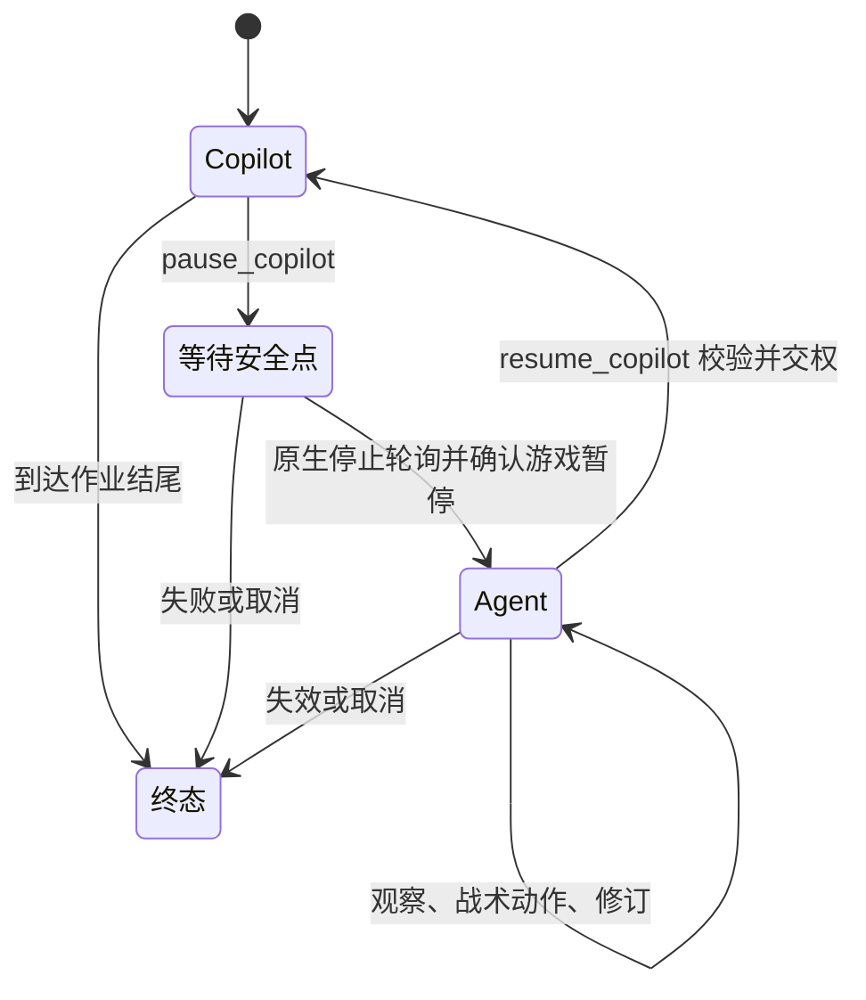

# P5 混合控制接口

`start_copilot(hybrid=true)` 运行原格式单关作业，并启用安全点接管。运行时须提供 `hybrid_control_v1`，可通过 `get_session_status.capabilities.hybrid_control` 检查。默认的 `hybrid=false` 继续使用传统 Copilot。编队、战前界面、药剂和单次运行的约束见 [Copilot 接口](copilot-interface.md)。当前实机覆盖普通 1-7 演习。



三个新工具均返回异步 Operation，通过 `get_operation` 查询终态。公共输入为 `session_id`、`epoch`、`run_id` 和 `request_id`。`run_id` 来自 `start_copilot.operation_id`。输入的完整 JSON Schema 由 `tools/list` 提供，源文件在 `src/maatactics/tool-input-schemas.json`。

| 工具 | 额外输入 | 成功结果 |
|---|---|---|
| `pause_copilot` | 可选 `timeout_ms`，1–60 秒，默认 60 秒 | 新 epoch、原生 checkpoint、已验证的游戏暂停状态和截图引用 |
| `revise_copilot` | `checkpoint_id`、`plan_revision`、`action_sequence`、`edits`，可选超时 1–60 秒 | 新 revision、校验结果和不可变 revision Resource URI |
| `resume_copilot` | `checkpoint_id`、`plan_revision`、`action_sequence`、`expected_snapshot_id`，可选超时 1–30 秒 | 新 epoch、已验证的游戏运行状态、原生恢复确认 |

暂停请求在下一处安全点生效。原生线程检查动作边界以及费用、击杀、冷却、计时和可部署条件的轮询位置。动作前后延迟、选择界面、正在执行的触控及技能动作属于不可中断的接管区间，可由取消终止整段运行。安全点停止作业轮询及技能策略，服务确认游戏已暂停后开放 Agent 输入。运行状态和游戏暂停状态分别返回。

Agent 使用 P4 的战术工具和截图，按需调用 `resume_battle` 打开运行窗口。暂停期间作业线程只处理原生请求，Agent 战术经同一 `TacticalBattleTask` 执行，更新原部署位置和技能记录。游戏确认或动作失败后可通过前后截图检查影响。作业的 `skill_usage` 继续由原生策略解释，Agent 侧的实验 Ready 字段仍无自动执行入口。

每次交权都使用新的 epoch。调用方从结果中的 `epoch` 更新会话引用。暂停中通过 `get_copilot_progress` 获取当前 checkpoint，Agent 动作成功后其中 `action_sequence` 会更新。下例以 `revise_copilot` 跳过原动作 3 并替换动作 4。

```json
{
  "session_id": "s-…",
  "epoch": 3,
  "run_id": "op-…",
  "request_id": "revision-2",
  "checkpoint_id": "1:1",
  "plan_revision": 1,
  "action_sequence": 5,
  "edits": [
    {"op": "skip", "index": 3},
    {"op": "replace", "index": 4, "action": {"type": "SpeedUp"}}
  ]
}
```

索引从 0 开始，跳过保留原索引。编辑范围为 `next_action_index` 及以后，每次最多 256 项和约 60 KiB。修改后的文档先通过隔离原生解析，再由 Worker 原子应用。正在等待条件的动作始终未提交输入，可被修订。该动作被修订时从新条件开始，其他条件继续使用原等待栈和费用基准。作业计时在接管期间冻结。修订 Resource 为 `maatactics://sessions/{session_id}/runs/{run_id}/revisions/{revision}.json`，随该会话最近一次混合运行保留。原始 Copilot 文档独立保存。

恢复同时核对 run、checkpoint、revision、动作序号、原生关卡绑定和最新截图。截图须属于当前 epoch 且在五秒内完成采集。服务再次观察 HUD 和原生上下文后才允许交权。暂停界面之外的手工触控可能造成引擎估计与游戏实际状态不一致，运行中应由 MCP 独占控制设备。

`CHECKPOINT_MISMATCH`、`EDIT_RANGE_INVALID` 或解析拒绝时可重新查询并修订。未知 HUD、原生上下文不一致、Worker 退出、动作失败、取消或超时会中止运行并使 checkpoint 失效。`stop_operations` 和 `disconnect_device` 会收回执行权。checkpoint 只在同一 Worker 内有效，重新连接后需建立新运行。断开本身不对游戏发出暂停输入。

`HybridActionCompleted` 带原索引、动作序号、plan revision、context revision、controller 和 engine return。具体动作仍返回 `game_effect=unknown`；游戏暂停与继续单独由视觉验证。`get_copilot_progress.progress.completed_action_count` 在混合模式下计数原生成功返回的作业动作，跳过和 Agent 动作分别记录。
